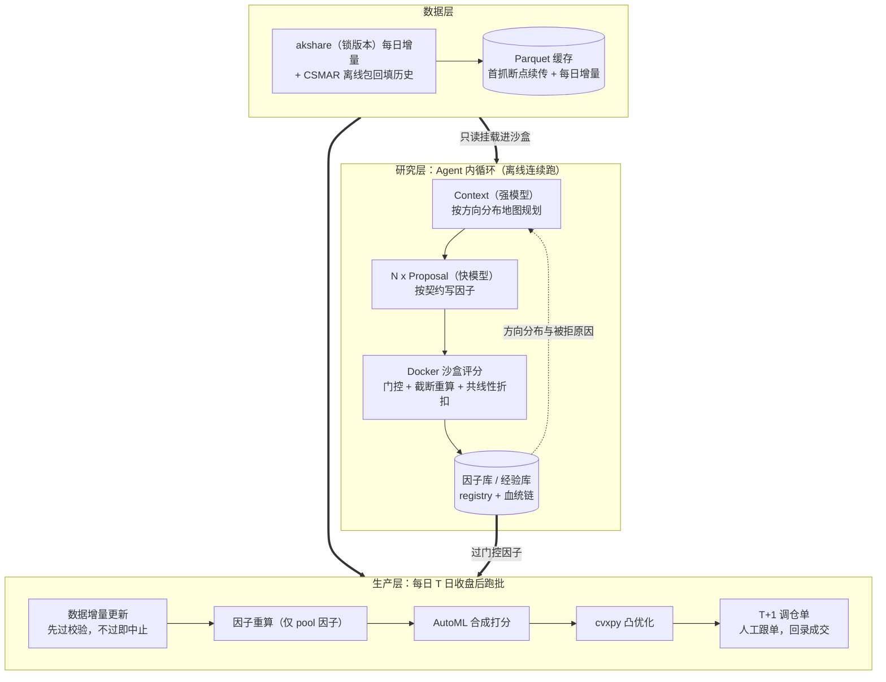

# ASTER 星菀

**ASTER: Autonomous System for Trading, Evaluation & Research**

A 股日频量化系统：Agent 内循环挖因子 + AutoML 合成信号 + 凸优化组合，每日产出目标持仓与可执行调仓单，人工跟单。

fork 自 [hyra-pi](https://github.com/001eander/hyra-pi)，单仓库双语言：TypeScript 编排层（内循环、调度）+ Python 执行层（数据、因子、回测、组合、跑批）。研究层与生产层解耦，因子库是两者之间的唯一接口。

> 个人量化项目，仅供研究与自用，不构成投资建议。

## 亮点

- **Agent 因子挖掘内循环**：Context 按因子库方向分布规划互补挖掘方向，Proposal 在断网 Docker 沙盒内写因子、由真实回测指标评分；共线性四层防御与血统链支撑多代进化，入库因子带指标与血统记录，可复用可审计
- **AutoML 合成信号**：AutoGluon（GPU）把因子库合成截面打分，训练配置随模型落盘，回测与跑批按同一配置复现
- **A 股全规则账户回测**：T+1、分板块涨跌停、整手、停牌、佣金印花税滑点、分红送转全覆盖；同一套账户模拟器驱动历史回测与每日跟单虚拟账户，回测里看到的换手、费用、拒单就是跟单时会遇到的
- **两种策略形态一份配置**：全市场选股 / 指数增强（基准锚定约束族），日 / 周 / 月调仓，一份 JSON 切换
- **调仓单可直接照做**：整手对齐、附参考价与预估金额，停牌与涨跌停提前过滤，盘前无需再加工
- **全链路本地化**：数据落 Parquet、模型本地训练、跑批无外部服务依赖，一台带显卡的机器即可完整运行

## 架构



无前视口径全局唯一：信号 cutoff = T 日收盘，成交 = T+1 开盘价 + 滑点，标签 = T+1 开盘到 T+2 开盘收益。因子级、模型级、账户级三层回测共享同一套标签与指标内核。

## 快速开始

环境要求：Python 3.12+ 与 [uv](https://docs.astral.sh/uv/)，Node 20+；因子挖掘内循环另需 Docker。有 NVIDIA 显卡时 AutoGluon 自动走 CUDA（torch 已锁 cu128 源）。

```bash
# 1. 安装依赖
uv sync                          # Python 执行层
npm install && npm run build     # TS 编排层

# 2. 数据初始化：首次全量抓取（默认 2021-09-29 至今，断点续传），随后体检
#    ASTER_NO_PROXY=1 用于绕过本机可能损坏的系统代理
ASTER_NO_PROXY=1 uv run python scripts/fetch_data.py
uv run python scripts/validate_data.py

# 3. 训练基线模型（AutoGluon，GPU）
uv run python scripts/train_baseline.py --start 2021-09-29 --end 2024-12-31 \
    --model-dir runs/automl/baseline --time-limit 1800 --presets medium_quality

# 4. 端到端回测（净值曲线、报告、持仓与风险四表）
uv run python scripts/backtest_e2e.py --model-dir runs/automl/baseline \
    --start 2025-01-02 --end 2026-09-28 --benchmark 000905 --risk-report \
    --out-dir runs/e2e

# 5. 每日跑批（T 日收盘后：先更新数据，再出 T+1 调仓单）
ASTER_NO_PROXY=1 uv run python scripts/daily_update.py
uv run python scripts/run_daily.py
```

跑批产物在 `runs/`：`orders/` 调仓单（CSV + Parquet）、`reports/` 跑批报告与简报、`account/` 虚拟账户。内循环启动、指数增强配置等完整步骤见 [wiki 快速开始](https://github.com/001eander/ASTER/wiki/Getting-Started)。

## 目录结构

```
src/                TS 编排层：内循环、经验库、灵感队列、沙盒调度、CLI
quant/              Python 执行层：数据、标签、因子接口、评估、因子库、
                    回测、组合优化、AutoML、股票池、每日跑批
prompts/            内循环 prompt（Context / Proposal）
tasks/              Agent 任务包（TASK.md + eval.sh 沙盒评分入口）
docker/             沙盒镜像（断网，数据只读挂载）
factor_library/     因子代码 + registry.json（入 git）
config/             策略与股票池配置
scripts/            抓取 / 训练 / 回测 / 跑批 CLI
tests/              pytest 与 vitest 测试
docs/               展示用固化产物
data/  runs/        本地数据与运行记录（不入 git）
```

测试：`uv run pytest`（Python）、`npm test`（TS）。

## 文档

- [GitHub Wiki](https://github.com/001eander/ASTER/wiki)：快速开始、架构、数据层、回测体系、策略配置、因子挖掘与开发、旗舰策略样板
- [AGENTS.md](AGENTS.md)：仓库约定与量化纪律
- [factor_library/README.md](factor_library/README.md)：因子接口约定、注册表 schema 与整库规则
- [docker/README.md](docker/README.md)：沙盒镜像构建与手动冒烟
- [tasks/factor-mining/TASK.md](tasks/factor-mining/TASK.md)：Agent 因子挖掘任务契约

## 风险与已知限制

- akshare 退市股历史覆盖不全，存在幸存者偏差，解读回测时需留意（CSMAR 离线包只覆盖其导出窗口，详见 wiki 数据层页）
- akshare 接口可能变动：锁版本 + 跑批前校验熔断 + 数据源抽象层隔离，坏了只改一处
- 所有回测结果不构成投资建议，跟单盈亏自负

## License

[GPLv2](LICENSE)（GNU General Public License v2.0）。
